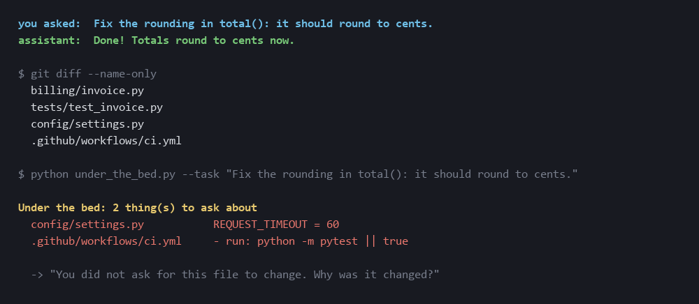

# under-the-bed

**The AI said "Done!". This shows what it hid in the diff.**


> RU: ИИ сказал «готово» — инструмент показывает, что он спрятал в диффе: проглоченные ошибки, выключенные тесты, заглушенные предупреждения.

## Try it in one minute

Python 3.8+, nothing to install. Inside any git repo with uncommitted changes:

```sh
curl -O https://raw.githubusercontent.com/klavdiy-core/under-the-bed/main/under_the_bed.py
python under_the_bed.py
```

No changes at hand? Run it on the example from the picture:

```sh
curl -O https://raw.githubusercontent.com/klavdiy-core/under-the-bed/main/examples/ai_cleanup.diff
python under_the_bed.py --diff ai_cleanup.diff
```

## What hurts

You ask an assistant to clean up, fix a bug, or make the tests pass. It says *"Done!"*. The diff looks tidy. Then you find:

- `except Exception: pass` where the bug used to be loud;
- `# type: ignore`, `as any`, `eslint-disable` sprinkled over the warnings;
- a test that now has `@skip`, or lost the assertion that was failing;
- `def export(rows, path, legacy_mode=False)` instead of a real fix;
- a fresh `make_slug()` that is `utils.slugify()` with the variables renamed;
- the old code kept as a comment "just in case", plus a `TODO` nobody will do.

When you point at it you get "Oh yeah, you're right!", but only for the one thing you happened to notice. People commit these diffs without reading them.

## What it does

It reads the diff and lists every one of those, with a question to paste back to the assistant:

| kind | what it catches |
|---|---|
| `swallowed-exception` | `except: …`, `except X: pass / ... / continue`, empty `catch {}`, `.catch(() => {})` |
| `silenced-check` | `# type: ignore`, `# noqa`, `pylint: disable`, `pyright: ignore`, `eslint-disable`, `@ts-ignore`, `@ts-nocheck`, `as any` / `: any`, `@SuppressWarnings`, `#[allow(…)]`, `//nolint`, `pragma: no cover` |
| `todo` | new `TODO` / `FIXME` / `HACK` / `XXX` comments |
| `commented-out-code` | new comments that are code, not prose |
| `weakened-test` | `skip`, `xfail`, `xit`, `.only`, `@Disabled`, `t.Skip` in test files, and test files that lost more assertions than they gained |
| `flag-parameter` | an existing function that grew a boolean or flag-like parameter |
| `duplicate` | a new function that is ≥ 90% the same as one already in the repo after renaming its locals (from 30 tokens), or an exact renamed copy of a short one (`make_slug` = `slugify`) |
| `file-grew` | a file that grew by 400+ lines in one change |
| `out-of-scope` | with `--task`: a file the task never points at (see below) |

No network, no LLM, standard library only. Python 3.8+. Works on Python, JS/TS, Go, Java/Kotlin, C#, Rust, C/C++, Ruby, PHP, Swift; the duplicate search knows Python and brace languages.

## Use

```sh
python under_the_bed.py                    # uncommitted changes (git diff HEAD)
python under_the_bed.py --staged           # what you are about to commit
python under_the_bed.py --range main       # the whole branch: main..HEAD
python under_the_bed.py --range HEAD~3     # the last three commits
git diff | python under_the_bed.py --diff -
python under_the_bed.py --json -o report.json
```

Exit code: `1` when something **hides a failure** (a swallowed exception, a switched-off or weakened test, a file you
did not ask to change), `0` otherwise, `2` on error. The rest (`noqa`, `type: ignore`, TODO, commented-out code, flag
parameters, copies) is listed under "Worth a look" and does not fail the run, so it can sit in a pre-commit hook or CI
without blocking ordinary commits. `--strict`: every finding fails the run, as in 0.1.

It knows a few idioms: `# noqa: E402` on an import after `sys.path.insert` (the usual test setup), a skip marker
inside a string or a regex (test data, not a skipped test), `except OSError: pass` right before a named fallback
(`return load_default()`), and a silencing marker the repo already uses three or more times in files the change does
not touch (marked "repo idiom"). Measured on the author's own last 14 commits: 75 findings and every one failing the
run became 45, of which 5 fail the run without `--task`.

0.4.0, measured on 10 real commits of another project (7 findings, 5 of them noise): a skip on the environment
(`skipUnless(sys.platform == "win32", ...)`, `skipif(sys.version_info < ...)`) is not a weakened test; a silence that
says why on the same line (`# noqa: BLE001 — a watcher never takes the turn down`) is not asked again; a parameter with
a flag-like name but a non-boolean default (`should_abort=None`, a callback) is not a flag; prose that starts with
"from" is not commented-out code, while a real `# import requests` now is; test files growing is not flagged. Two
common shapes are listed as info instead of failing: a damaged record skipped while reading (`json.loads` / `int()`,
then `except ValueError: continue`) and a failed write of the error log itself. The same diff now gives 2 findings,
both worth a look; the example above still gives its 7.

Brand-new files only show up once they are staged (`git add`), because `git diff HEAD` does not see untracked files.

### Changes you did not ask for: `--task`

"Oh my bad, I changed it because I thought it would work." Tell under-the-bed what you asked, and every file the task
never points at becomes a question:

```sh
python under_the_bed.py --task "Fix the rounding in total(): it should round to cents."
python under_the_bed.py --task-file TASK.md
```



A file is in scope when the task names its path or file name, names its folder, or names an identifier (`total()`,
`tax_for`, `` `parseDate` ``) that appears in its changed lines or in the function around them. Tests of an in-scope
file and the helpers next to those tests are in scope too. It is word matching, not understanding: when the task
names nothing it can find in the diff ("make it faster"), you get one line saying the scope cannot be checked, not a
list of accusations.

### Acknowledged findings: `--baseline`

Once you have read a finding and decided it stays, record it so it stops showing up:

```sh
python under_the_bed.py --range main --write-baseline .under-the-bed-baseline.json   # record what is there now
python under_the_bed.py --range main --baseline .under-the-bed-baseline.json         # show only what is new
```

A finding is identified by its file, its kind, its normalized snippet, and its occurrence number in the file. Two
identical copies of the same snippet are two findings: when only the first is recorded, the second still shows.
`--baseline` only hides what you recorded. It does not change what is found, and it does not reduce the noise
of automated reviewers. A missing baseline file is an error (exit `2`), not an empty baseline.

One honest edge: the occurrence number counts copies in scan order. If a new identical copy is added *above* the one
you acknowledged, the numbers shift and the older copy is the one that shows up. The count of new findings is right;
the line it points at may be the old one. Rewrite the baseline after you look.

### Example

[`examples/ai_cleanup.diff`](examples/ai_cleanup.diff) is a "fixed the EU tax bug" change of the kind an assistant writes:

```
$ python under_the_bed.py --diff examples/ai_cleanup.diff
```

```markdown
# Under the bed: 3 thing(s) that hide a failure, 4 worth a look

## billing/invoice.py

- [ ] **L14 swallowed-exception**: Why is this error swallowed? What should happen when it fires, and where will anyone see it?

## tests/test_invoice.py

- [ ] **L20 weakened-test**: Why is this test switched off? Is the code it guards broken now?
- [ ] **L21 weakened-test**: This change removes 2 assertion(s) and adds 1. What is no longer checked, and why is that safe?

## Worth a look (does not fail the run)

### billing/invoice.py

- [ ] **L10 flag-parameter**: `total` grew a flag `skip_tax`. Which callers pass it, and why is this not two functions, or a fix of the one?
- [ ] **L16 commented-out-code**: Why is dead code kept in a comment? Git remembers it. Can it go?
- [ ] **L17 todo**: Who does this TODO, and when? If it is needed, why is it not done in this change?
- [ ] **L18 silenced-check**: Which warning does this silence, and why is hiding it better than fixing it?
```

(full report with snippets: [`examples/ai_cleanup.report.md`](examples/ai_cleanup.report.md))

Paste the list back to the assistant. Make it answer each line, not the one you happened to notice.

### Noise

On ordinary human commits it stays quiet: the last 30 commits of `psf/requests` gave 3 findings, the last 30 of `colinhacks/zod` gave 6, all of them real `noqa` / `pyright: ignore` / `as any` lines. A finding is a question, not a verdict: sometimes the `noqa` is right. Then the answer is one sentence.

`@ts-expect-error` inside test files is not reported: there the error is the assertion.

## Limits

- Heuristics on lines, not a parser. It reads what the diff added, so a swallowed exception split across a context line can slip by.
- `flag-parameter` needs the old and the new signature in the same diff.
- The duplicate search reads the working tree (up to 5000 files, 300 KB each), skipping `node_modules`, `venv`, `dist` and dot-folders; with `--range A..B` it reads the code at `A`, as it was before the change, not today's files. A function under 30 tokens counts only as an exact copy (locals renamed), so short helpers that merely look alike stay quiet; functions under 8 tokens and test cases (`test_*` in test files, which look alike by nature) are not compared. `--no-dupes` turns it off.

## Test

```sh
python -m unittest discover -s tests
```

Diff fixtures with planted mess (each kind must be found, with the exact count) and a clean diff full of near misses (`except ValueError:` that logs, prose comments, a test that adds assertions, a type test with `@ts-expect-error`) that must give zero findings.

## License

MIT
